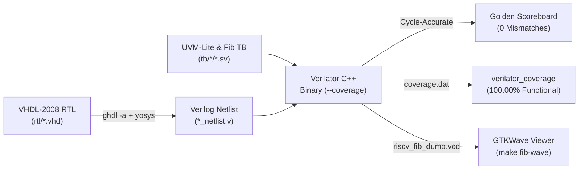

# Verification Plan (VPlan): Full RV32I Hierarchy & Fibonacci System Sign-Off

> **Methodology:** Constrained-Random UVM-Lite + Directed RV32I Assembly Execution | **Regression:** `make sim-all && make TOP_MODULE=riscv_core fib-sim` | **Coverage:** `100.00%` Across All 6 Modules

---

## 1. Mixed-Language Verification Flow

---

## 2. UVM-Lite Verification Closure Matrix (All 6 Modules)
| Module | Testbench (`tb/*`) | Transactions | Coverpoints & Crosses Verified | Functional Coverage | Code Coverage Summary |
| :--- | :--- | :---: | :--- | :---: | :--- |
| **`alu`** | `tb/alu/` | 256 | `cp_ctrl` (10 ops), `cp_zero`, `cp_rs1_sign`, `cp_rs2_sign`, `cross_op_signs` | **100.00%** (56/56) | Toggle: 100.0% (472/472) |
| **`reg_file`** | `tb/reg_file/` | 256 | `cp_rst`, `cp_we`, `cp_rd_add`, `cp_rs1_add`, `cp_rs2_add`, `cp_raw_hazard`, `cross_we_rd` | **100.00%** (21/21) | Toggle: 100.0% / Expr: 95.6% |
| **`imgen`** | `tb/imgen/` | 256 | `cp_format` (8 opcodes), `cp_sign`, `cp_imm_corners`, `cross_fmt_sign` | **100.00%** (30/30) | Toggle: 78.8% (216/274) |
| **`pc_reg`** | `tb/pc_reg/` | 200 | `cp_rst`, `cp_pc_next` (zero/aligned/unaligned/max), `cp_pc_out`, `cross_rst_pc` | **100.00%** (12/12) | Toggle: 100.0% (266/266) |
| **`ctrl_unit`** | `tb/ctrl_unit/` | 256 | `cp_opcode` (9 RV32I classes), `cp_funct3` (0..7), `cp_f7`, `cp_aluctrl` (10 ops) | **100.00%** (29/29) | Toggle: 96.0% (96/100) |
| **`riscv_core`** | `tb/riscv_core/` | 256 | `cp_rst`, `cp_opcode` (all 9 RV32I classes), `cp_dmem_we` + Golden ISS Reference | **100.00%** (13/13) | Toggle: 94.7% / Branch: 94.6% / Expr: 96.2% |

---

## 3. Directed System-Level Fibonacci Program Test (`tb/riscv_fib/riscv_fib_tb.sv`)
Beyond constrained-random verification against the cycle-accurate Golden Instruction Set Simulator (ISS) in `riscv_core_trans.sv`, the synthesized `riscv_core` was verified end-to-end by executing a compiled 16-instruction **RV32I Fibonacci machine-code program** (`imem[0..15]`) across **66 clock cycles**:

* **Initialization (`PC = 0x00`..`0x18`):** Sets `x1 = 0` (`F(0)`), `x2 = 1` (`F(1)`), pointer `x4 = 0`, and loop counter `x5 = 9` via `addi`, then stores `F(0)=0` (`Cycle 06`) and `F(1)=1` (`Cycle 07`) to `dmem[0]` and `dmem[1]` via `sw`.
* **7-Instruction Iterative Loop (`PC = 0x1C`..`0x34`):** Executes `add`, `sw`, four `addi` register/pointer/counter updates, and backward conditional branch `bne x5, x0, -24` across 9 iterations (writing `F(2)=1` through `F(10)=55` every 7 clock cycles at Cycles `10, 17, 24, 31, 38, 45, 52, 59, 66`).
* **Load-Back & Halt (`PC = 0x38`..`0x3C`):** Verifies `lw x6, 0(x4)` reading `55` (`0x37`) from `dmem[10]` (`0x28`) before parking at `jal x0, 0`.
* **Self-Checking Data RAM Sign-Off:** Automatically verifies all 11 memory words (`dmem[0..10]` = `(0, 1, 1, 2, 3, 5, 8, 13, 21, 34, 55)` — **11/11 PASS**) and exports `../work/riscv_core/riscv_fib_dump.vcd`.
